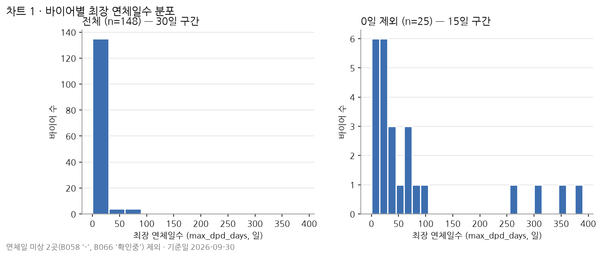
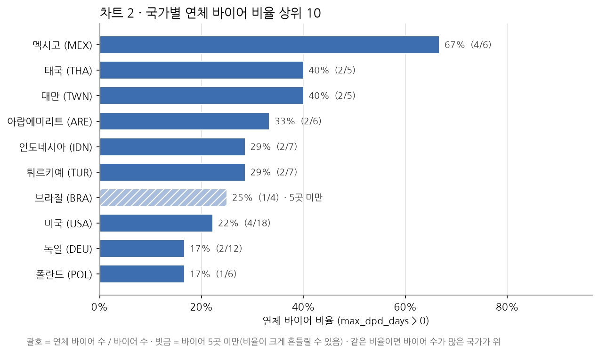
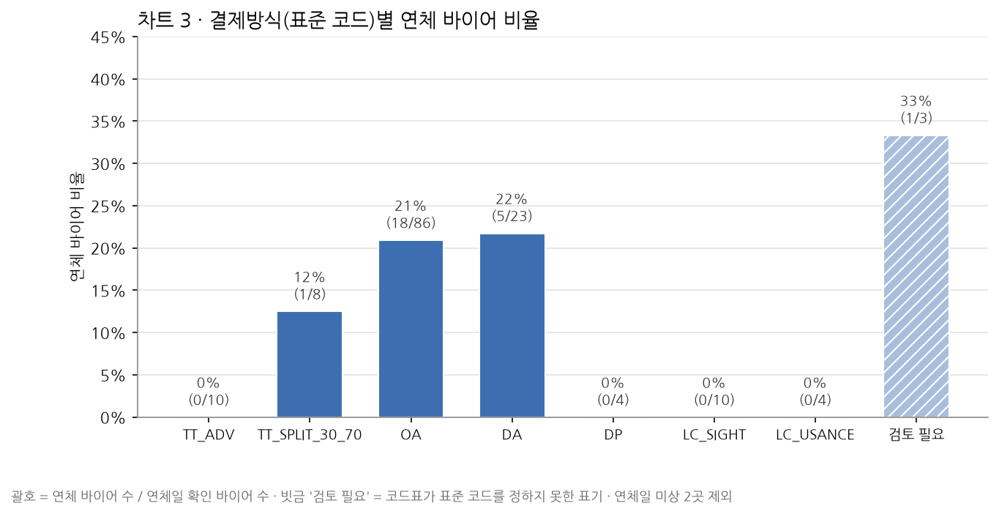

# 1일차 · 바이어 EDA 노트

- 노트북: `workbench/day1/notebooks/d1_eda.ipynb` · 정리 규칙과 코드: `scripts/d1_eda_prep.py`
- 원본 `data/day1/d1_buyers_raw.xlsx`(153행) → buyer_id 중복 3행 제거 → **150곳**. 결제조건은 `d1_code_table.csv`로 표준 코드 변환
- 연체 바이어 = `max_dpd_days > 0`. 연체일 미상 2곳(B058 `-` · B066 `확인중`)은 비율의 분모 · 분자에서 뺌
- 비율 = 연체 바이어 수 ÷ (바이어 수 − 연체일 미상)

## 차트 1 · 최장 연체일수 분포

1. 연체일을 아는 148곳 중 123곳(83.1%)은 0일이고, 연체 바이어는 25곳(16.9% = 25/148)입니다. 전체 그림은 0일 막대에 묻혀 꼬리가 거의 보이지 않아 0일을 뺀 그림을 함께 봐야 합니다.
2. 연체 25곳의 중앙값은 31일이지만 평균은 81일입니다. 코드표 aging 구간으로 1-30일 12곳 · 31-60일 4곳 · 61-90일 5곳 · 91일 이상 4곳이라, 대부분은 짧은 지연이고 소수의 장기 연체가 평균을 끌어올립니다.
3. 91일 이상 4곳(B071 269일 · B083 305일 · B044 355일 · B147 381일)은 따로 떨어져 있습니다. 이 중 B044 · B147은 K-SURE 미부보(N)입니다. 원본 연체일만 본 값이라, 인보이스 원장으로 재계산해 대조하는 것은 `확인 필요`입니다.

## 차트 2 · 국가별 연체 바이어 비율 상위 10

1. 멕시코가 67%(4/6)로 가장 높고, 태국 · 대만 40%(2/5), 아랍에미리트 33%(2/6)가 뒤를 잇습니다. 다만 상위 10개국 중 8곳이 바이어 7곳 이하라 1곳만 달라져도 비율이 14~25%p 움직입니다.
2. 바이어가 가장 많은 미국(4/18, 22%)과 독일(2/12, 17%)은 수가 많아 비율이 상대적으로 안정적입니다. 태국 2곳(B044 355일 · B147 381일)은 연체 바이어 수는 적어도 연체 기간이 가장 깁니다.
3. 바이어 5곳 미만 국가는 4곳(브라질 4 · 이집트 4 · 말레이시아 3 · 나이지리아 3)이고, 상위 10에는 브라질(1/4)만 들어 빗금으로 표시했습니다. 분모는 연체일을 아는 바이어 기준이라 아랍에미리트는 B066을 뺀 6곳입니다. 연체 0곳인 7개국은 상위 10에 들지 않았습니다.

## 차트 3 · 결제방식(표준 코드)별 연체 바이어 비율

1. 연체 바이어는 OA(18/86, 20.9%)와 DA(5/23, 21.7%)에 모여 있습니다. 연체 25곳 중 23곳이 이 두 방식이고, 선적 후 대금을 받는(수출자가 위험을 지는) 조건입니다.
2. TT_ADV · DP · LC_SIGHT · LC_USANCE는 모두 0%이고, TT_SPLIT_30_70은 12.5%(1/8, B087)입니다. 이 다섯 방식을 합쳐도 36곳이라 '0%'를 '위험이 없다'로 일반화하기에는 표본이 작습니다.
3. '검토 필요' 3곳 중 연체 1곳은 B085(`10% T/T advance + 90% O/A 90 days`, 22일)입니다. 대부분이 사후송금 조건이라 OA와 비슷하게 볼 수도 있지만, 표준 코드는 사람이 정해야 합니다. 이 차트는 결제방식과 연체가 함께 나타난다는 것만 보여 주며, 결제방식이 연체의 원인이라는 근거는 아닙니다.

### 결제방식별 바이어 수 · 연체 바이어 수 · 연체 바이어 비율

| 결제방식(표준 코드) | 바이어 수 | 연체일 미상 | 연체 바이어 수 | 연체 바이어 비율 |
|---|---|---|---|---|
| TT_ADV | 10 | 0 | 0 | 0.0% |
| TT_SPLIT_30_70 | 8 | 0 | 1 | 12.5% |
| OA | 87 | 1 | 18 | 20.9% |
| DA | 24 | 1 | 5 | 21.7% |
| DP | 4 | 0 | 0 | 0.0% |
| LC_SIGHT | 10 | 0 | 0 | 0.0% |
| LC_USANCE | 4 | 0 | 0 | 0.0% |
| 검토 필요 | 3 | 0 | 1 | 33.3% |
| 합계 | 150 | 2 | 25 | 16.9% |
